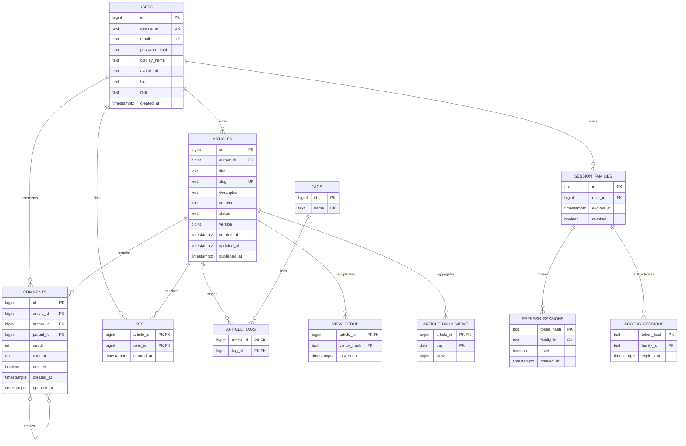

# Архитектура и модель данных

## Слои

Модульный монолит обслуживает блог как одну согласованную транзакционную систему. Отдельные файлы модулей users/articles/comments/sessions/statistics позволяют развивать функции без сетевых границ и распределённых транзакций. PostgreSQL обеспечивает необходимые блокировки и атомарность. Redis и фоновые очереди для этого объёма задач не нужны.

HTTP отвечает за протокол: chi, JSON и query, заголовки, bearer authentication middleware, CORS, размер тела и rate limit. Валидация бизнес-полей и проверки автора/admin находятся в service, поэтому не зависят от конкретного HTTP-маршрута. Domain содержит сущности, отдельные публичные/приватные DTO, типизированные ошибки, правила видимости и даты. Repository отвечает за SQL и границы транзакционных операций. Config и cmd создают инфраструктуру, pool, slog, сервер и завершение.

Направление зависимостей: `cmd → httpapi → service → repository → pgx`; domain не зависит от HTTP или PostgreSQL. Интерфейсы добавляются при реальном наличии альтернативных адаптеров; искусственный интерфейс ко всем методам Store здесь усложнил бы навигацию. Интеграционные тесты SQL используют реальный PostgreSQL, а чистые бизнес-инварианты тестируются без БД.

`domain.Error` несёт status/code/message/details. HTTP добавляет request_id. `pgx.ErrNoRows` → 404, unique violation → 409, FK/CHECK → 422. Ошибки инфраструктуры дают 500 без внутренних подробностей. Чужой черновик при чтении даёт 404; запрещённое редактирование и аналитика — 403. Эти решения закреплены в OpenAPI и тестах.

## ER-диаграмма

## Целостность и индексы

Все пользовательские ID — PostgreSQL generated identity bigint. UNIQUE закрепляет username, нормализованный email, slug и имя тега. PRIMARY KEY `(article_id,user_id)` гарантирует один лайк независимо от конкурентности Go. Связь тегов уникальна по `(article_id,tag_id)`. У комментариев составной FK `(parent_id,article_id)` исключает ответы в другой статье; CHECK depth и trigger проверки parent исключают глубину >1. Статус статьи ограничен draft/published, публикация согласована с ненулевой published_at, версия положительная. Ограничения длины текста продублированы в БД.

Индексы:

- `(author_id,status,id DESC)` — выборка материалов автора и публичных списков.
- `(published_at DESC,id DESC)` с условием published — порядок публикаций.
- GIN `to_tsvector('simple', title || ' ' || description || ' ' || content)` — полнотекстовый поиск.
- `(tag_id,article_id)` — фильтр тегов, PK в обратном направлении — загрузка тегов статьи.
- `(article_id,id)` — список комментариев и счётчик; PK лайков начинается с article_id.
- PK дневных просмотров `(article_id,day)` и `(day,article_id)` — история статьи и диапазоны статистики.
- PK дедупликации `(article_id,visitor_hash)` и last_seen — условная регистрация и очистка.
- Индексы user_id/family_id — сессии аккаунта и каскадное удаление; PK token_hash — lookup токена.

`article_metrics` — обычный SQL VIEW: дневные суммы, текущие лайки и неудалённые комментарии предварительно сгруппированы по статье. Несколько one-to-many JOIN не перемножают счётчики. Рейтинг вычисляется в запросе; для сортировки по views/popularity PostgreSQL выполняет вычисление и сортировку результатов, отдельного индекса на динамические значения нет. Это сознательное решение для небольшого блога: нет производных кешей и рассинхронизации. При росте данных после EXPLAIN/замеров можно добавить поддерживаемую в транзакциях таблицу totals с индексами ранжирования.

Автор JOIN-загружается в одной выборке списка; теги агрегируются коррелированным SQL подзапросом внутри этой же выборки, без дополнительных round trips на каждую статью. Периодические показатели списка аналитики получаются одной дополнительной выборкой по массиву ID, не N+1. Все пользовательские значения — параметры SQL; ORDER BY выбирается из закрытой карты. Count и items списка статей находятся в одной REPEATABLE READ snapshot.

## Конкурентные операции

**Редактирование:** сервис проверяет владельца по неизменяемому author_id, затем транзакция делает `UPDATE ... WHERE id=$1 AND version=$2`. Version увеличивается вместе с полями и тегами; affected rows=0 → 412. Физическое удаление проверяет ту же версию. Счётчики не меняют редакционную версию.

**Лайки:** транзакция блокирует статью `FOR UPDATE`, проверяет published и выполняет INSERT ON CONFLICT DO NOTHING или DELETE. Ответный счётчик вычисляется внутри той же транзакции. Блокировка сериализует взаимодействие со снятием публикации/удалением, UNIQUE гарантирует идемпотентность.

**Просмотры:** та же блокировка статьи исключает просмотр после снятия публикации; автор/admin пропускаются. Время берётся через `clock_timestamp()` после получения блокировки, чтобы долгождущий запрос не использовал время начала транзакции. UPSERT дедупликации обновляет last_seen только если предыдущий учитываемый просмотр старше или равен границе окна. При успешном UPSERT дневной агрегат увеличивается на 1 в той же транзакции. При сбое оба изменения откатываются. Отдельная очередь не нужна. Цена — сериализация всех взаимодействий с одной очень популярной статьёй; для MVP это простой и проверяемый выбор.

**Refresh:** токен указывает на семейство. Транзакция блокирует семейство, затем перечитывает used, revoked и срок. Успешная ротация помечает старый used и добавляет новые хеши. Повторное использование помечает семейство revoked и **фиксирует** эту операцию до возврата 401. Возврат ошибки до commit отозвал бы только локальные изменения, поэтому invalid-флаг возвращается после успешного commit. Access проверяет семейство на каждом запросе. Конкурентный refresh не выдаёт два живых продолжения: второй запрос обнаружит used и отзовёт семейство. Клиент обязан сериализовать refresh.

## Удаление и хранение

Статья удаляется физически: не оставляем скрытые тексты и связанные пользовательские данные без продуктовой необходимости. FK ON DELETE CASCADE удаляют теги-связи, лайки, комментарии, дедупликацию, дневные просмотры. Неиспользуемые записи tags остаются справочником и не отображаются публично; их объём небольшой. Аккаунтные данные связаны FK, удаление пользователя каскадное на уровне БД; HTTP удаления аккаунта не предусмотрен. При физическом удалении автора корневого комментария его ответы также удаляются через parent FK ON DELETE CASCADE; обычный HTTP DELETE комментария использует tombstone и сохраняет ответы.

Комментарий удаляется мягко с очисткой content, поскольку reply должен сохранить родительскую точку в дереве. Его author/time остаются публичными при доступе к публикации; счётчик активных комментариев уменьшается. В ответе явный deleted=true. Снятая с публикации статья сохраняет связанные записи для автора, но исчезает из публичной статистики и поиска.

Сырые события просмотров не храним: нужен лишь rolling dedup и дневные агрегаты. Дневные агрегаты сохраняются весь срок статьи, без visitor IDs/IP. View dedup можно удалять после окна; скрипт maintenance запускается оператором ежедневно. Хеши использованных refresh сохраняются до абсолютного истечения семейства; затем удаляются каскадно. Access с истёкшим TTL тоже очищается. Команда повторяема, транзакционна; при падении процесс просто запускается снова. Постоянного фонового процесса или работы, требующей recovery queue, нет.

Счётчики просмотров пересчитываются как SUM(article_daily_views.views), лайков — COUNT(likes), комментариев — COUNT(comments WHERE NOT deleted), популярность — формула над ними. Это SELECT, а не ремонт кеша. Из дневных данных нельзя восстановить индивидуальные события/уникальных посетителей, и контракт этого не обещает. Дневные агрегаты восстанавливаются из бэкапа PostgreSQL, если они были утрачены.
